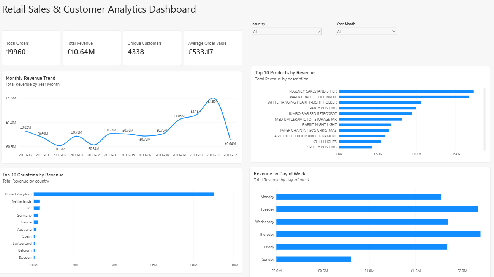

# Retail Sales & Customer Analytics Dashboard

An end-to-end data analytics project analyzing retail transaction data to identify sales trends, customer behavior, product performance, and geographic revenue patterns.

The project uses Python, Pandas, SQL, SQLite, Power BI, and DAX to transform raw transaction data into meaningful business insights and an interactive dashboard.

## Project Overview

The goal of this project was to analyze retail sales data and answer common business questions such as:

- How much revenue did the business generate?
- How many orders and customers were recorded?
- Which months generated the highest revenue?
- Which products performed best?
- Which countries contributed the most revenue?
- Which days of the week generated the most sales?
- Which customers generated the highest revenue?

## Technologies Used

- Python
- Pandas
- SQL
- SQLite
- Power BI
- DAX
- Git
- GitHub

## Dataset

The project uses the **Online Retail dataset** from the UCI Machine Learning Repository.

The original dataset contains:

- 541,909 transaction rows
- 8 original columns
- Transactions from December 2010 to December 2011
- Sales from customers across 38 countries

The original columns include:

- Invoice Number
- Stock Code
- Product Description
- Quantity
- Invoice Date
- Unit Price
- Customer ID
- Country

## Data Exploration

Initial data exploration identified:

- 541,909 rows
- 5,268 duplicate rows
- 1,454 missing product descriptions
- 135,080 missing customer IDs
- Negative quantities associated with returns/cancellations
- Negative and zero-value pricing records requiring validation

## Data Cleaning

Python and Pandas were used to:

- Standardize column names
- Convert invoice dates to datetime format
- Remove duplicate records
- Remove rows without product descriptions
- Identify cancelled invoices
- Filter invalid sales transactions
- Retain transactions with positive quantities and prices
- Create a revenue field
- Create Year, Month, Year-Month, Day-of-Week, and Hour fields
- Create indicators for known customer records

After cleaning, the dataset contained:

**524,878 valid sales transaction rows**

## Key Business KPIs

- **Total Revenue:** £10.64M
- **Total Orders:** 19,960
- **Unique Customers:** 4,338
- **Units Sold:** 5,572,420
- **Average Order Value:** £533.17

## Key Findings

### Monthly Revenue

November 2011 was the highest-revenue full month, generating approximately:

**£1.50M**

Revenue increased significantly during the final months of 2011.

December 2011 contains only partial-month data because the dataset ends on December 9, 2011.

### Product Performance

After excluding non-product entries such as postage and manual charges, some of the strongest products by revenue included:

- REGENCY CAKESTAND 3 TIER
- PAPER CRAFT, LITTLE BIRDIE
- WHITE HANGING HEART T-LIGHT HOLDER
- PARTY BUNTING
- JUMBO BAG RED RETROSPOT

### Geographic Performance

The **United Kingdom** generated approximately **£9.00M** in revenue and represented the largest market in the dataset.

Other strong markets included:

- Netherlands
- EIRE
- Germany
- France
- Australia

### Customer Analysis

The highest-revenue identified customer generated approximately:

**£280K**

Customer-level analysis was performed using order count, units purchased, total revenue, and average order value.

### Day-of-Week Performance

Thursday generated the highest revenue at approximately:

**£2.20M**

No Saturday sales transactions appeared in the cleaned dataset.

## SQL Analysis

The cleaned dataset was loaded into an SQLite database containing **524,878 rows**.

SQL queries were created to analyze:

- Overall business KPIs
- Monthly revenue
- Top countries
- Top products
- Top customers
- Revenue by day of week

SQL operations used include:

`SELECT`, `SUM`, `COUNT`, `DISTINCT`, `ROUND`, `GROUP BY`, `ORDER BY`, `CASE`, `WHERE`, and `LIMIT`.

Database indexes were also created for invoice number, customer ID, country, and Year-Month fields.

## Power BI Dashboard

The interactive Power BI dashboard includes:

- Total Revenue KPI
- Total Orders KPI
- Unique Customers KPI
- Average Order Value KPI
- Monthly Revenue Trend
- Top 10 Products by Revenue
- Top 10 Countries by Revenue
- Revenue by Day of Week
- Country filter
- Year-Month filter



## Project Structure

```text
RetailSalesAnalytics/
|
|-- data/
|   |-- raw/
|   |   `-- online_retail.csv
|   |
|   |-- cleaned/
|   |   `-- online_retail_cleaned.csv
|   |
|   |-- analysis/
|   |   |-- monthly_sales_summary.csv
|   |   |-- product_summary.csv
|   |   |-- country_summary.csv
|   |   |-- customer_summary.csv
|   |   `-- day_of_week_summary.csv
|   |
|   `-- retail_sales.db
|
|-- python/
|   |-- download_data.py
|   |-- explore_data.py
|   |-- clean_data.py
|   |-- analyze_data.py
|   |-- build_database.py
|   `-- run_sql_analysis.py
|
|-- sql/
|   `-- analysis_queries.sql
|
|-- dashboard/
|   `-- Retail_Sales_Customer_Analytics_Dashboard.pbix
|
|-- screenshots/
|   `-- Dashboard.png
|
|-- requirements.txt
|-- .gitignore
`-- README.md
```

## How to Run

Create and activate a Python virtual environment, install the dependencies, and run the scripts in order.

```bash
pip install -r requirements.txt

python python/download_data.py
python python/explore_data.py
python python/clean_data.py
python python/analyze_data.py
python python/build_database.py
python python/run_sql_analysis.py
```

## Author

Charanya Ananthula  
Computer Science Major | Data Science Minor  
Kutztown University of Pennsylvania